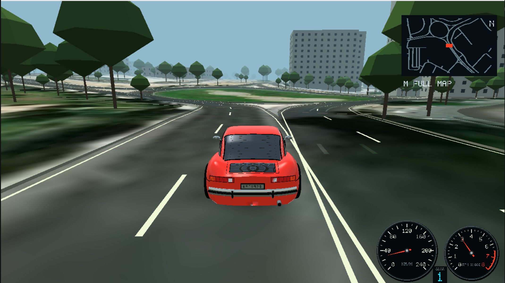

# Cars LOP

--- human info begins ---

Experimental project: have an AI create a decent game and not even read the code.
Every commit message is an "ask" to the coding agent.
Everything else, including README.md outside of this section, is generated.

--- human info ends ---

A driving game inspired by NFS5: beautiful cars, pleasant roads, readable handling
and mechanical personality.



## Contents

- [Build and play](#build-and-play)
  - [Controls](#controls)
  - [Locations](#locations)
- [Add a city](#add-a-city)
- [Nicosia map](#nicosia-map)
- [Optional source tools](#optional-source-tools)
- [Vehicle handling](#vehicle-handling)
- [Car assets](#car-assets)
  - [Mesh format](#mesh-format)
  - [Tuning existing cars](#tuning-existing-cars)
  - [Adding cars without recompiling](#adding-cars-without-recompiling)
  - [Turbo tuning](#turbo-tuning)
  - [Kestrel Turbo](#kestrel-turbo)
- [Engine audio and recording credits](#engine-audio-and-recording-credits)
- [Development](#development)
- [Credits and distribution](#credits-and-distribution)
- [Backlog](#backlog)

## Build and play

Requires Rust and the platform's SDL3/OpenGL libraries. The game and map tools
are one executable.

```sh
cargo build --release
./target/release/nfs5like
```

Choose a location and car, then start free driving.

### Controls

| Key | Action |
| --- | --- |
| Up / Down | Accelerate / brake |
| Left / Right | Steer |
| A / Z | Shift up / down (includes neutral between first and reverse) |
| Space | Handbrake |
| Tab | Cycle Close → Wide → Bonnet cameras |
| Esc | Pause / resume, or close the full map and return to driving |
| R | Restart |
| C | Recover the car |
| M | Open the full map (pauses driving) |
| Mouse wheel / + / - | Zoom the full map in / out |
| L | Return to location and car selection |
| V | Toggle audio mute |

The bonnet camera follows steering immediately and smooths vertical bumps and
pitch changes to keep the horizon steady.

The current street name appears below the minimap while driving. Names come from
the location’s OSM source, preferring English when available; unnamed roads and
off-road driving are labeled accordingly. Built-in routes show their route name.

The full map opens centered on your car at the minimap's scale. Zooming keeps
the car centered; zoom out to see the entire road network. Reopening the map
resets the zoom to the minimap's scale.

### Locations

Running without arguments lists the built-in routes and all imported locations
without loading city assets. Choose a location, then Start Driving to load it.
Use Left/Right to browse or click the page arrows for more locations.
`--location` preselects a city in the menu. To drive in Nicosia:

```sh
./target/release/nfs5like play --location nicosia
```

Nürburgring is also available as an offline location, covering the Nordschleife,
Grand Prix circuit, connecting lanes and surrounding roads:

```sh
./target/release/nfs5like play --location nurburgring
```

Its package is `data/locations/nurburgring.sqlite`, built from the
[Geofabrik Rheinland-Pfalz extract](https://download.geofabrik.de/europe/germany/rheinland-pfalz.html)
with Skadi N50E006 and N50E007 elevation. Bounds: `50.315 6.910 50.390 7.015`.
This is a free-drive map with generated scenery. Circuit bridge sections follow
the terrain surface; banking, bridge decks and circuit-specific barriers are
not reconstructed.

Built-in tracks need no city files. For city play, keep its `data/locations/NAME.sqlite`
package beside the executable. Play works offline.
Use `./target/release/nfs5like --help` for command syntax.

## Add a city

The workflow is **map file → city extract → import with elevation → play**.
Build the game first (`cargo build --release`) and run the commands below from
the project root.

### 1. Get the map and elevation files

Download these two files before importing:

**Map:** Open [Geofabrik Downloads](https://download.geofabrik.de/), select your
continent, then the country or smallest available region containing your city.
Download the **`.osm.pbf`** file (not the Shapefile or GeoPackage).
For Engomi, use [Cyprus](https://download.geofabrik.de/europe/cyprus.html) →
[cyprus-latest.osm.pbf](https://download.geofabrik.de/europe/cyprus-latest.osm.pbf).

**Elevation:** Use the **Skadi `.hgt.gz`** tiles from
[Mapzen Terrain Tiles](https://registry.opendata.aws/terrain-tiles/).
For Engomi and Nicosia, download
[N35E033.hgt.gz](https://elevation-tiles-prod.s3.amazonaws.com/skadi/N35/N35E033.hgt.gz).
It covers latitude 35–36° N and longitude 33–34° E. Keep it compressed.

To download both example files from a terminal:

```sh
curl -fL --create-dirs -o /tmp/city-import/cyprus.osm.pbf \
  https://download.geofabrik.de/europe/cyprus-latest.osm.pbf
curl -fL --create-dirs -o /tmp/city-import/N35E033.hgt.gz \
  https://elevation-tiles-prod.s3.amazonaws.com/skadi/N35/N35E033.hgt.gz
```

For another city, choose the elevation tile by its **southwest corner**, rounding
latitude and longitude down to whole degrees. For example, 35.162° N, 33.320° E
falls in `N35E033`; −33.9°, −70.7° falls in `S34W071`.
The download URL follows this pattern (replace both coordinate names):

```text
https://elevation-tiles-prod.s3.amazonaws.com/skadi/N35/N35E033.hgt.gz
```

The directory is the latitude part (`N35`); the filename includes latitude and
longitude (`N35E033.hgt.gz`). See the [Skadi format documentation](https://github.com/tilezen/joerd/blob/master/docs/formats.md#skadi).

Choose a small neighbourhood for your first import. Write down its bounds in
**south, west, north, east** order: minimum latitude, minimum longitude, maximum
latitude, maximum longitude, all in decimal degrees.

Elevation tiles must cover the whole area plus padding, with no missing samples.
For areas spanning tile boundaries, put the adjacent tiles in the same directory
and supply any tile covering the area to `--elevation`. Tiles must have matching
resolution. Keep coordinate filenames such as `N35E033.hgt.gz`; the importer
finds neighbouring `.hgt` or `.hgt.gz` files automatically and preserves them in
the package.

The commands below import Engomi using the two downloads above.
For your own city, replace the map path, elevation path, bounds and location name.

### 2. Extract the city from the regional map

```sh
./target/release/nfs5like extract-region \
  /tmp/city-import/cyprus.osm.pbf \
  /tmp/city-import/engomi.osm \
  --bbox 35.156 33.312 35.168 33.328
```

This writes `/tmp/city-import/engomi.osm`, the XML map used in the next step.
Always provide your city's bounds; the extractor otherwise defaults to Nicosia.

Already have a complete `.osm` XML export? Skip this step and use that file as
`--source` below. It must include all nodes referenced by its roads and buildings.
`add-location` cannot read PBF or Overpass JSON directly.

### 3. Import the map with elevation

```sh
./target/release/nfs5like add-location engomi-demo \
  --source /tmp/city-import/engomi.osm \
  --bbox 35.156 33.312 35.168 33.328 \
  --elevation /tmp/city-import/N35E033.hgt.gz
```

- `engomi-demo` is the name you will select when playing. Choose an unused name.
  Use English letters, digits, hyphens or underscores,
  start with a letter or digit, and keep it under 65 characters.
- `--source` is the XML file from step 2.
- `--bbox` is the same crop as in step 2.
- `--elevation` is the tile covering that crop. Elevation is required.

Wait for **`Added engomi-demo`**. The import also builds the city's visuals;
no separate bake command is needed. Large cities take more time, memory and disk
space. Existing locations are never overwritten.

### 4. Launch the city

```sh
./target/release/nfs5like play --location engomi-demo
```

Keep `data/locations/engomi-demo.sqlite`: the game reads its assets when you play.
Use the same location name and storage directory as in step 3. To see all imported
cities in that directory:

```sh
./target/release/nfs5like list-locations
```

### Updating a city

To change the map, bounds or elevation, repeat the import under a new name.
After renderer changes, rebuild an existing city's visuals with:

```sh
./target/release/nfs5like bake-city --location engomi-demo
```

If a city is not listed, check `--locations-dir` and your working directory.
An absolute storage path avoids this ambiguity. Locations default to
`data/locations`; override this with `--locations-dir` or `NFS_LOCATIONS_DIR`.

New cities use generated materials by default. Use
[city-wide imagery preparation](#prepare-imagery-and-trees-for-the-whole-city)
to add imagery and inferred trees.

## Nicosia map

The bundled map covers about 289 km² of Nicosia, including Engomi, Strovolos,
Lakatamia, Aglandjia and Gonyeli. Assets live in `data/locations/nicosia.sqlite`.

OpenStreetMap supplies roads, building footprints, green spaces and street
furniture. Heights and architectural details are partly estimated. Low curbs,
pavements and parking areas are drivable; buildings remain solid.

Bridges, tunnels and some complex buildings are omitted. Some roads remain
disconnected. One-way rules are not enforced, and city traffic is not simulated.

The location package contains the aerial imagery; set
`NFS_NO_AERIAL=1` to disable it. The city-wide preparation command below extends
coverage beyond the original 445 × 445 m Engomi pilot.
See [redistribution limits](#credits-and-distribution) before sharing it.

## Optional source tools

All map tools are part of the game executable. Keep downloads, caches and previews
in a temporary directory; `data/locations/` holds the playable city packages and
their rebuild inputs. Imported cities preserve their source XML and elevation tile,
so temporary input files can be removed after a successful import.

```sh
# Merge saved OSM snapshots; gzip inputs are supported.
./target/release/nfs5like merge-osm original.osm.gz extension.osm /tmp/merged.osm

# Prepare your own saved image and Web Mercator export metadata.
./target/release/nfs5like build-aerial-tiles --image /path/to/image.jpg --export /path/to/export.json --output /tmp/aerial-tiles
```

### Preview trees from imagery

```sh
./target/release/nfs5like preview-trees \
  --image /path/to/image.jpg \
  --export /path/to/export.json \
  --city-data data/locations/nicosia.sqlite \
  --output /tmp/tree-preview
```

Open `/tmp/tree-preview/review.html` to inspect candidates. Road and building
conflicts are crossed out automatically. You can override decisions and download
the reviewed GeoJSON. `--osm FILE.osm` optionally highlights existing mapped trees.

To replace a city's imagery-tree supplement with accepted proposals:

```sh
./target/release/nfs5like import-imagery-trees \
  --candidates /tmp/tree-preview/kept-candidates.geojson \
  --city-data data/locations/nicosia.sqlite
./target/release/nfs5like bake-city --location nicosia
```

Heights and crown sizes are estimates. Detection can mistake shrubs, grass and
shadows for trees. The original OSM trees remain unchanged.

### Prepare imagery and trees for the whole city

```sh
./target/release/nfs5like prepare-city-imagery \
  --city-data data/locations/nicosia.sqlite \
  --work-dir /tmp/nicosia-imagery
./target/release/nfs5like bake-city --location nicosia
```

This explicitly downloads World Imagery for the city's bounds, prepares terrain
textures, detects trees, and excludes roads, buildings and duplicates. Rerun with
the same work directory to resume. `--limit-blocks 2` downloads a sample without
changing city assets. Allow several gigabytes of disk space for preparation.

After a successful preparation and bake, the work directory can be deleted.
Keep the `.sqlite` file: it includes imagery, trees, roads, buildings, terrain,
source records and the baked scene.
Provider metadata, preparation settings and coverage counts remain inside the
package as `aerial/service.json`, `aerial/plan.json` and `aerial/source.json`.
Gameplay stays offline; the imagery cache uses at most 64 MiB of GPU memory.

World Imagery covers northern neighbourhoods where the DLS source returns blank
images. Image dates and sharpness vary. These are local development assets;
redistribution permission has not been established.

### Single-file location packages

Each location is one self-contained SQLite file, such as
`data/locations/nicosia.sqlite`. Geometry chunks and imagery tiles are read on
demand; the game does not unpack the location or load the whole database.
Assets are split into independently compressed 256 KiB blocks with checksums.
Road collision data requires the lossless binary asset `streets.bin`,
including prebuilt spatial lookup grids. New imports and `bake-city` generate
it automatically. To optimize an existing package without rebuilding visuals:

```sh
./target/release/nfs5like bake-collision --location nicosia
```

Startup checks the binary data against the city and road sources. Missing,
outdated or damaged binary data stops loading with a rebuild instruction.
`./rebuild.sh` builds the release executable and rebuilds collision data for
Nicosia and Nürburgring from their existing source assets. The script records
the commands used for this rebuild; run it again after changing road sources.
Packaged road hashes are checked without decompressing the text. The binary
asset uses uncompressed, checksummed blocks to reduce startup CPU work; for
Nicosia it adds about 401 MiB to the package. Road and collision data remain in memory while driving.
SQLite is bundled into the executable; no database server is needed.

```sh
# Convert an existing location folder; the original folder is preserved.
./target/release/nfs5like pack-location /path/to/location data/locations/my-city.sqlite

# Check database integrity, every compressed block, and all asset hashes.
./target/release/nfs5like verify-location data/locations/my-city.sqlite

# Extract source records or edit a location offline.
./target/release/nfs5like unpack-location data/locations/my-city.sqlite /tmp/my-city
```

New imports publish `.sqlite` packages automatically. `bake-city --location NAME`
updates the baked scene in the package after intentional edits to city inputs or
when you want to adopt new geometry-generation behavior. Published locations use
their embedded geometry and do not need rebaking after game rebuilds or source
code changes. Existing packages with build fingerprints remain playable; scene
format versions and integrity checks still apply. Imagery preparation and tree-import
commands also accept a `.sqlite` path for `--city-data`; they use a temporary
working folder and replace the package after a successful update. Allow extra
disk space during offline edits. Finalized packages need no sidecar files.

## Vehicle handling

Vehicles use a nonlinear front/rear axle tire model, integrated at steps no
larger than 1/240 second. Steering creates tire forces and a yaw moment about
the center of mass. Rear-engine Kestrel, rear-drive Muscle, and front-drive Club
have separate weight distributions, yaw inertias, brake biases, and axle
stiffnesses in `data/cars/{kestrel,muscle,club}/car.json`, loaded at startup. These values are gameplay calibrations rather than
measured specifications or a recreation of NFS5's internal physics.

Acceleration and braking transfer load between axles. Lateral transfer reduces
available grip through tire load sensitivity. Drive, braking, and cornering
share each axle's friction budget; hard acceleration can saturate driven tires,
and the handbrake locks the rear axle. Foot braking retains ABS-like regulation.
Tire forces peak and soften into sliding grip, so front and rear breakaway and
countersteering arise from forces rather than a target rotation rate. Keyboard
steering still ramps progressively and reduces lock with speed. Kestrel has
additional speed-dependent lock reduction, a firmer rear-axle response, and
forward brake bias so held turns and braking into corners produce progressive
breakaway rather than abrupt rear sliding.
Above 60 km/h, the additional steering restriction grows linearly with speed
to retain useful lock for faster bends. Adding steering input always increases
the front-wheel angle, including during a held turn. Brake pressure progressively
restores the stronger restriction to reserve tire grip while braking into a turn.

Engine torque varies with RPM, passes through the selected gear and final drive,
and is interrupted during gear changes. Closed-throttle engine braking
also depends on gearing. Kestrel retains its wheel-power/drag limit; the other
cars use their torque curves against route-specific road load. Wheelspin feedback reflects
driven-axle saturation, but there is no independent wheel angular-inertia solver.

A damped spring supports chassis height and permits unloading, flight, and
landing over changes in ground height. Pitch and roll respond to acceleration
through damped springs; curb impacts retain their small feedback bump. This is
an axle model with one vertical chassis degree of freedom, not four independent
suspension corners or a full 3D rigid body. Collision shapes and damage modeling
remain simplified.

## Car assets

Each car has one folder containing its definition and assets:

```text
data/cars/
  kestrel/
    car.json
    model.glb
    audio/
  kestrel-turbo/
    car.json
    model.glb
  muscle/
    car.json
    model.glb
  club/
    car.json
    model.glb
```

Car designs are runtime assets. Set `"model": "model.glb"` in `car.json` to
load a glTF 2.0 binary asset containing the body and four wheels. Replace the
GLB or edit its path, then restart; rebuilding is unnecessary. Paths are relative
to that car's folder. Handling, gearing, and sound remain in JSON. Missing or
invalid required designs stop loading with the asset filename and error;
invalid extra cars are skipped with a warning. There is no compiled-in design
fallback. GLB is the only supported car artwork format.

Audio loads `data/cars/kestrel/audio/engine.json` and its mono 48 kHz signed
16-bit little-endian `.pcm` loops once at startup, relative to the working
directory. Kestrel and Kestrel Turbo share this six-band flat-six bank. Adjacent
RPM bands crossfade with constant-power weights; each band's load/coast loops
use their own measured source pitch. Loops keep advancing while inaudible so
RPM and throttle transitions never restart playback. Restart after replacing
assets; rebuilding is unnecessary. A missing/invalid bank warns and falls back
to the procedural engine voice. The version-1 manifest requires 2–16 bands in
strictly increasing RPM order, `sample_rate: 48000`, and a local `.pcm` filename,
`pulse_hz`, and `overlap` for each `load`/`coast` entry. Each loop must have an
even byte count, more than twice its overlap in samples, and at most 960,000
bytes. Keep all of `data/cars` with packaged builds. Audio fallback operates
independently of mesh loading.

See [Kestrel sound credits and conversion commands](#engine-audio-and-recording-credits).

### GLB artwork

Export a static, triangulated glTF 2.0 **GLB** with all geometry in its embedded
binary buffer. Use meters, Y up, +Z forward, and these unique node names:

| Node | Contents |
| --- | --- |
| `body` | Body and attached details |
| `wheel_rl` | Rear wheel on the negative-X side |
| `wheel_rr` | Rear wheel on the positive-X side |
| `wheel_fl` | Front wheel on the negative-X side |
| `wheel_fr` | Front wheel on the positive-X side |

Each part may contain child meshes. Place each wheel node's origin at its axle;
its world-space origin supplies the wheel mount. Wheel geometry rotates about
car-local X and front wheels steer about Y. Node rotations/scales and parent
transforms are baked into geometry, including inverse-transpose normals and
mirrored winding. Body geometry uses car-local coordinates, with the car origin
at the same ride-height reference as the existing cars. Keep JSON `wheelbase`,
track width, and rolling radius consistent with the artwork: they still control
physics, while GLB wheel nodes control visual mounts and tire feedback locations.

The importer supports indexed/unindexed triangle meshes, optional normals
(flat normals are generated when absent), `COLOR_0`, and solid PBR base colors.
Base color multiplies vertex color. Metallic/roughness values map to the current
renderer’s finish controls; this is not a full glTF PBR renderer. For selected
paint tint and the existing glass/metal/lens finishes, add material custom
properties exported as glTF `extras`, for example:

```json
{ "extras": { "carslop_material": [1, 0.82] } }
```

The first value is the finish code documented below; the second is specular
strength in 0–1. Without these extras, materials keep their authored colors.
Textures, alpha transparency, skins, morph targets, baked animations, sparse
accessors, external buffers, and required extensions are rejected with an error.
Animate wheels through the game's steering/spin logic. Export opaque glass using
finish code 2 until transparency support is added.

The original wheels have a 0.4 m radius; keep replacement wheels consistent
with the JSON gearbox rolling radius. `carslop_material` finish code 1 receives
the selected car tint; code 0 remains untinted. Code 2 selects reflective glass,
code 3 metal, and code 4 optical lenses, retaining their authored colors. Code 5
marks brake lenses, which glow red while the foot brake is held, even at rest or
in reverse. Existing untinted red rear lenses are recognized automatically.
The parking brake and engine braking do not activate stop lights. The
second value controls specular strength. Paint uses a clear-coat response, and
finish materials reflect an analytic daylight sky and ground. Triangle winding
and normals must face outward. Edit artwork in a glTF-capable modeling tool and
export directly to GLB.

Kestrel has continuous sculpted wings and shoulders, a tucked-under sill, open
wheel arches with recessed liners, a curved fastback roof, thin framed glazing,
tilted fluted headlamps, wraparound signals, chrome and rubber bumpers, panel
shutlines, wipers, fuel flap, rear cooling grille and a hollow exhaust tip.
Its five-petal alloy wheels have polished lips, recessed centres, lug nuts and
rounded, grooved tires.

To inspect the actual game renderer from front, rear and side, including closer
detail views (requires SDL3/OpenGL):

```sh
NFS_CAR_PREVIEW_DIR=artifacts/car-quality cargo test kestrel_art_preview -- --ignored --test-threads=1
```

Muscle and Club have authored body shells with smooth panel normals, open wheel
arches, inset glazing, window seals, mirrors, door seams, grilles and separate
light lenses. Muscle retains its long fastback, twin bonnet scoops and quad
headlights; Club retains its tall hatch, rectangular lamps and roof spoiler.

### Tuning existing cars

`data/cars/kestrel/car.json`, `data/cars/muscle/car.json`, and
`data/cars/club/car.json` are the required runtime parameter
files for the original cars. Edit them and restart the executable to change
names, handling, power/drag, gearbox, or the selected GLB without rebuilding.
These files contain complete definitions; custom cars inherit their current
values. Missing or invalid required files stop loading with the filename and
error, rather than silently using compiled-in tuning. Ship these files with
all builds. `model` selects the GLB containing the body and four wheel nodes;
edit wheel placement through those nodes in the GLB.

### Adding cars without recompiling

Create `data/cars/my-coupe/car.json` and put its assets in the same folder, then
restart the existing executable. Car folders are discovered at startup in folder
name order and appended to the three original cars. Folders without `car.json`
and loose JSON files are ignored. Invalid custom definitions are skipped with a
warning. Use the menu or left/right car selection to select new entries;
F1–F3 remain shortcuts for the original cars.

For example, save this as `data/cars/my-coupe/car.json`:

```json
{
  "base": "kestrel",
  "name": "MY COUPE",
  "description": "CUSTOM ROAD COUPE",
  "mass": 1100,
  "engine_force": 9500,
  "top_speed": 60,
  "model": "my-coupe.glb",
  "gearbox": {
    "ratios": [2.833, 1.778, 1.217, 0.962, 0.821],
    "final_drive": 4.428571
  }
}
```

`base` is required: `kestrel`, `muscle`, or `club`. Other fields inherit that
base's settings. Omit `model` to reuse its artwork. A replacement GLB must
contain all five named parts; its path is relative to the JSON file. Engine sound
inherits the base voice. Wheel mounts come from the named GLB nodes.

All handling values use SI units (`top_speed` is meters per second). Supported
scalar overrides are `mass`, `engine_force`, `top_speed`, `brake_force`,
`lateral_force`, `wheelbase`, and `steering_response`. The optional `dynamics`
object accepts `front_weight`, `cg_height`, `track_width`, `yaw_inertia`,
`front_drive`, `brake_bias`, `corner_stiffness` (front/rear array), `peak_torque`,
`suspension_hz`, and `steering_speed_squared`. The `gearbox` object also accepts
`rolling_radius`, `reverse_ratio`, `upshift_rpm`, and `downshift_rpm`; ratios
must be positive and descending. `road_engine` accepts `wheel_power_watts` and
`drag_accel`, or `null` to disable the power/drag model. Keep JSON definitions
and referenced assets with the executable's working-directory `data/cars`.

The [Kestrel Turbo](#kestrel-turbo) is a 930-inspired wide-body variant,
loaded through the same runtime catalog as other custom cars.

### Turbo tuning

Optional `turbo` enables boost lag and a procedural airflow whoosh. Set it to
`null` for a naturally aspirated engine. Its fields are `off_boost_fraction`
(0..1 of rated torque/power), `spool_start_rpm`, `full_boost_rpm` (greater than
start), `spool_seconds` and `decay_seconds` (positive exponential time constants).
The engine torque and power tune represents full boost; boost follows throttle,
RPM and gear changes. The whoosh follows turbine spool, including its coast-down.

### Kestrel Turbo

A fictional Kestrel variant inspired by the 1975 Porsche 911 Turbo 3.0 (930).
Select **KESTREL TURBO** in the car menu. `data/cars/kestrel-turbo/` is a runtime car package;
adding it to an existing build's `data/cars` and restarting discovers it.

The body uses the same authored coachwork as Kestrel, with wider front arches
and rear haunches, a swept whale-tail rear spoiler with a rounded rubber edge,
a recessed spoiler grille, deeper front chin, black window trim and impact-bumper
strips. No Porsche artwork or badges are used. Both variants share the new
five-petal wheel design; engine recordings are inherited from the original
Kestrel. Each package keeps its own GLB artwork.

Reference: [Porsche's 1975 Turbo 3.0 museum specification](https://newsroom.porsche.com/dam/jcr%3A3c07547c-36bc-4e00-825c-5ac2bbe10805/Datenblatt%20911%20Turbo%203.0%20Coup%C3%A9.pdf.PDF)
lists 191 kW / 260 PS, 1140 kg, 250 km/h, and 5.5 seconds to 100 km/h.
[Porsche's historical feature](https://newsroom.porsche.com/en_AU/2020/Lifestyle/porsche-klassik-magazine-guus-reinerink-taycan-turbo-23297.html)
lists 350 Nm and a four-speed gearbox (and a different 1195 kg weight).
We use the museum's 1140 kg specification.

The runtime tune uses 171.9 kW at the wheels (90% of 191 kW), rear drive,
four forward gears, firmer suspension and more rear grip. Gear ratios,
shift points, drag, launch force, brakes, inertia, and tire forces are game
calibrations, not a certified reproduction. The existing Kestrel axle positions
and wheel radius are retained to match the adapted mesh. The turbo builds boost progressively with throttle and RPM, loses pressure on
lift-off and shifts, and adds an airflow whoosh that grows brighter and stronger with spool speed.
Rated torque and wheel power represent full boost. All tuning is in `data/cars/kestrel-turbo/car.json`;
all geometry is in that folder's mesh files.

## Engine audio and recording credits

All files below are in `data/cars/kestrel/audio/` unless otherwise stated.

### Active flat-six RPM bank

`engine.json` and `flat6-*.pcm` use Pole Position Production's **1981 Porsche
911 SC 3.0-litre exhaust recording**, provided in the free Sonniss GDC 2016
bundle. Six blend anchors cover 1,150, 2,000, 2,600, 3,500, 4,400 and 5,100 RPM;
the highest band pitches upward to the game's 6,500 RPM redline. Load and coast
use distinct excerpts, except idle. Their labels are inferred from exhaust
level/tone; the source has no throttle or tachometer telemetry.

See [the full source, license, excerpt times and calibration notes](data/cars/kestrel/audio/CREDITS.md).
These are licensed game assets under the [Sonniss GDC bundle license](https://sonniss.com/gdc-bundle-license/),
not CC0 recordings. The uncut original stays outside the distributed assets.
Rebuild with Python, NumPy/SciPy and ffmpeg:

```sh
python3 tools/build_engine_audio.py artifacts/audio/source/porsche-911-sc-1981.wav
```

Muscle and Club retain their procedural voices. Rolling noise, tire scrub and
turbo airflow are procedural. The mono engine source is placed in stereo by
the camera-listener audio system. Tire scrub builds into a wavering, band-limited
squeal with increasing slip and speed, with smoothed onset and release.

### Legacy idle recording (unused)

`engine-source.wav`: domasx2, **racing car engine sound loops**, `loop_0.wav`.
Source: https://opengameart.org/content/racing-car-engine-sound-loops
Download: https://opengameart.org/sites/default/files/loop_0.wav
License: CC0 1.0, https://creativecommons.org/publicdomain/zero/1.0/
The author describes the current upload as derived from a public-domain car
recording. Retrieved 2026-10-30. The other files in that pack are pitch variants
of the same recording; they are deliberately not presented as separate RPM captures.

`roadster-engine.pcm` is the old mono 48 kHz signed 16-bit little-endian
playback derivative, no longer referenced by the active bank. Recreate with:

```sh
ffmpeg -i data/cars/kestrel/audio/engine-source.wav -af 'highpass=f=28,volume=1.2' -ar 48000 -ac 1 -f s16le data/cars/kestrel/audio/roadster-engine.pcm
```

### Legacy V8 running recordings (unused, separate license)

`engine-load-source.wav` / `engine-coast-source.wav`: `Acc_05570.wav` /
`Dec_05581.wav` from **Generic V8 Engine Sound**.
Sound made by DerMeehdrescher / Meehdrescher Studios.
Source: https://opengameart.org/content/generic-v8-engine-sound
Download: https://opengameart.org/sites/default/files/genericv8sound.zip
License: Creative Commons Attribution-ShareAlike 4.0 International,
https://creativecommons.org/licenses/by-sa/4.0/
Retrieved 2026-10-30. The originals and their modified PCM derivatives are
distributed under that license. Changes: mono downmix, 30 Hz high-pass filter,
raw signed 16-bit little-endian export; runtime pitch/filter/crossfade processing.
The active flat-six bank replaces these generic V8 stand-ins.

Recreate each derivative with:

```sh
ffmpeg -i data/cars/kestrel/audio/engine-load-source.wav -af highpass=f=30 -ac 1 -ar 48000 -f s16le data/cars/kestrel/audio/engine-load.pcm
ffmpeg -i data/cars/kestrel/audio/engine-coast-source.wav -af highpass=f=30 -ac 1 -ar 48000 -f s16le data/cars/kestrel/audio/engine-coast.pcm
```

To render an offline driving audition (no audio device required):

```sh
mkdir -p artifacts/audio
NFS_AUDIO_PREVIEW=artifacts/audio/driving.wav cargo test recorded_driving_preview -- --ignored --nocapture
```

For an isolated tire audition (gentle cornering, building slide, recovery, then
a slower skid):

```sh
NFS_TIRE_PREVIEW=artifacts/audio/tires.wav cargo test tire_squeal_preview -- --ignored --nocapture
```

## Development

Run tests:

```sh
cargo test
```

Rebuild the bundled city's visuals after renderer changes:

```sh
./target/release/nfs5like bake-city --location nicosia
```

## Credits and distribution

Map data © [OpenStreetMap contributors](https://www.openstreetmap.org/copyright).
Saved OSM sources and OSM-derived map databases are distributed under ODbL 1.0;
game code and original generated materials are separate. Preserve attribution
and source provenance when sharing city assets. The bundled map uses the
[Geofabrik Cyprus extract](https://download.geofabrik.de/europe/cyprus.html);
source records are stored inside the package as `manifest.json` and
`sources/manifest.json`.

Elevation: [Mapzen Terrain Tiles](https://registry.opendata.aws/terrain-tiles/),
using the [Skadi N35E033 tile](https://elevation-tiles-prod.s3.amazonaws.com/skadi/N35/N35E033.hgt.gz).
Terrain data courtesy of USGS; European terrain produced using Copernicus data
and information funded by the European Union (EU-DEM). See the provider's
[source attribution and licensing](https://github.com/tilezen/joerd/blob/master/docs/attribution.md).
Local source records are stored as `elevation/heightfield.json` inside the package.

City-wide imagery: Esri World Imagery — Source: Esri, Vantor, Earthstar
Geographics, and the GIS User Community. See the
[provider service](https://server.arcgisonline.com/ArcGIS/rest/services/World_Imagery/MapServer).

Original pilot imagery: Cyprus Department of Lands and Surveys,
[Orthoimagery 2019 WebMercator service](https://eservices.dls.moi.gov.cy/arcgis/rest/services/BASEMAPS/Orthoimagery_2019_WebMercator/MapServer).
Redistribution permission for the local imagery pack has not been established;
do not redistribute packages containing this imagery or its derived assets
unless authorised.

## Backlog

### World

- [ ] Make Nicosia the default location.
- [ ] Add a downloader for arbitrary cities.
- [ ] Show real-world coordinates in game to identify locations.

### Cars

- [ ] Review handbrake side-sliding realism.
- [ ] Add a Mazda Demio.

### HUD

- [x] Add a full map view (M to open, Esc to return; L opens location and car selection).

### Sound

- [ ] Improve engine realism with dedicated mid-RPM recordings.
