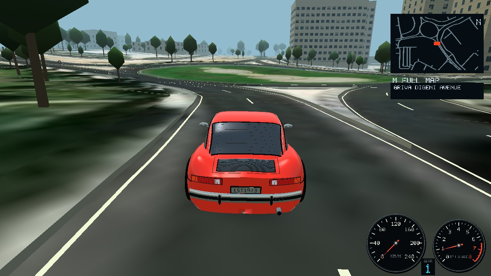

# Cars LOP

--- human info begins ---

Experimental project: have an AI create a decent game and not even read the code.
Every commit message is an "ask" to the coding agent.
Everything else, including README.md outside of this section, is generated.

--- human info ends ---

A driving game inspired by NFS5: beautiful cars, pleasant roads, readable handling
and mechanical personality.



[Screenshot location: Engomi, Nicosia](https://www.google.com/maps/search/?api=1&query=35.1670537,33.3169556)

## Build and play

Requires Rust and the platform's SDL3/OpenGL libraries. The game and map tools
are one executable.

```sh
cargo build --release
./target/release/nfs5like
```

Choose a location and car, then start free driving.

### Controls

| Key | Action |
| --- | --- |
| Up / Down | Accelerate / brake |
| Left / Right | Steer |
| A / Z | Shift up / down (includes neutral between first and reverse) |
| Space | Handbrake |
| C / Tab | Cycle Close → Wide → Bonnet cameras |
| Esc | Pause / resume, or close the full map and return to driving |
| R | Restart |
| H | Recover the car |
| M | Open / close the full map (pauses driving) |
| Mouse wheel / + / - | Zoom the full map in / out |
| L | Return to location and car selection |
| V | Toggle audio mute |

For a burnout start, hold Up + Down at rest to rev with the clutch open, then
release Down while holding Up. A revved neutral-to-first shift also works.

The bonnet camera is fixed to the rendered body and follows its steering,
pitch, roll and vertical suspension movement.

The current street name appears in large text at the bottom center while driving. Names come from
the location’s OSM source, preferring English when available. Unnamed roads are
labeled accordingly; the street label clears when driving off road. Built-in routes show their route name.

Named OSM buildings have facade-mounted storefront signs, preferring `name:en`
and falling back to the local name. Signs face the closest street and use world
geometry, so they follow perspective and are hidden by buildings and terrain.

The full map opens centered on your car at the minimap's scale. Zooming keeps
the car centered; zoom out to see the entire road network. Reopening the map
resets the zoom to the minimap's scale. On imported maps, press **C** in the full
map to copy the car’s current location as a Google Maps URL. A confirmation
appears on the map; fictional built-in routes have no geographic location.

### Locations

Running without arguments lists Coastal Highway and all imported locations
without loading city assets. Choose a location, then Start Driving to load it.
Use Left/Right to focus the location/car lists, then Up/Down to browse.
Click the page arrows for more locations.
`--location` preselects a city in the menu. To drive in Nicosia:

```sh
./target/release/nfs5like play --location nicosia
```

Nürburgring is also available as an offline location, covering the Nordschleife,
Grand Prix circuit and their racing connections, with surrounding scenery:

```sh
./target/release/nfs5like play --location nurburgring
```

Its package is `data/locations/nurburgring.sqlite`, built from the
[Geofabrik Rheinland-Pfalz extract](https://download.geofabrik.de/europe/germany/rheinland-pfalz.html)
with Skadi N50E006 and N50E007 elevation. Bounds: `50.315 6.910 50.390 7.015`.
This is a free-drive map with generated scenery. Circuit bridge sections follow
the terrain surface; banking, bridge decks and circuit-specific barriers are
not reconstructed.

Coastal Highway combines coastal straights, open sweeps, climbing S bends and
opposing mountain hairpins. It needs no city files. For city play, keep its `data/locations/NAME.sqlite`
package beside the executable. Play works offline.
Use `./target/release/nfs5like --help` for command syntax.

## Import and maintain maps

Locations are offline SQLite packages in `data/locations/`. Keep the package
beside the game; map source files are only needed for imports and rebuilding.

1. Download an `.osm.pbf` region from [Geofabrik](https://download.geofabrik.de/).
2. Download matching [Skadi elevation tiles](https://registry.opendata.aws/terrain-tiles/).
   A tile is named for its southwest whole-degree corner: Nicosia uses
   [N35E033.hgt.gz](https://elevation-tiles-prod.s3.amazonaws.com/skadi/N35/N35E033.hgt.gz).
   Keep adjacent tiles together when importing across tile boundaries.
3. Extract a small area, then import it with the same bounds, in
   **south, west, north, east** order:

```sh
./target/release/nfs5like extract-region cyprus.osm.pbf /tmp/engomi.osm \
  --bbox 35.156 33.312 35.168 33.328
./target/release/nfs5like add-location engomi-demo --source /tmp/engomi.osm \
  --bbox 35.156 33.312 35.168 33.328 --elevation N35E033.hgt.gz
./target/release/nfs5like play --location engomi-demo
```

An existing complete OSM XML export can skip extraction. PBF and Overpass JSON
cannot be passed directly to `add-location`. Names use letters, digits, `-`, `_`,
start with a letter or digit, and contain at most 64 characters. Existing
locations are never overwritten by import; use a new name to replace source data.

```sh
# Rebuild visuals and collision data after editing a location's inputs.
./target/release/nfs5like bake-city --location nicosia
# Rebuild just one cache.
./target/release/nfs5like bake-scene --location nicosia
./target/release/nfs5like bake-collision --location nicosia
# Inspect, extract or package a location.
./target/release/nfs5like verify-location data/locations/nicosia.sqlite
./target/release/nfs5like unpack-location data/locations/nicosia.sqlite /tmp/nicosia
./target/release/nfs5like pack-location /tmp/my-city data/locations/my-city.sqlite
```

`./rebuild.sh` builds the release executable and refreshes collision data for
bundled maps. New imports bake visuals automatically. Packages retain source
XML, elevation, imagery, metadata and checksummed geometry; they stream geometry
and imagery during play. Missing or stale collision data produces a rebuild
instruction. No database server is needed.

### Imagery and trees

```sh
# Download imagery for the whole city and infer additional trees.
./target/release/nfs5like prepare-city-imagery \
  --city-data data/locations/nicosia.sqlite --work-dir /tmp/nicosia-imagery
./target/release/nfs5like bake-scene --location nicosia
```

Use `--limit-blocks 2` for a sample without changing city assets. Reusing the
work directory resumes downloads; allow several GB of temporary storage.
World Imagery dates and sharpness vary. These imagery packages have not been
cleared for redistribution; see [credits](#credits-and-distribution).

For manually reviewed trees, run `preview-trees`, open the output `review.html`,
review candidates and download the accepted GeoJSON, then run
`import-imagery-trees` followed by `bake-scene`. Roads, buildings, duplicate trees
and out-of-bounds candidates are excluded. Estimated crowns can mistake shrubs
or shadows for trees; original OSM trees are preserved.

## Car assets and handling

Each car has `data/cars/NAME/car.json` and `model.glb`. Restart after editing.
The three base definitions are complete; extra folders inherit from `kestrel`,
`muscle` or `club` and are discovered at startup. Invalid extra cars are skipped
with a warning; invalid required cars stop loading with the filename and error.

```json
{
  "base": "kestrel",
  "name": "MY COUPE",
  "description": "CUSTOM ROAD COUPE",
  "mass": 1100,
  "model": "model.glb"
}
```

Omit `model` to inherit the base artwork. Paths are relative to the car folder.
Handling uses SI units; `top_speed` is m/s. Scalar overrides: `mass`,
`engine_force`, `top_speed`, `brake_force`, `lateral_force`, `wheelbase`,
`steering_response`. `dynamics` accepts `front_weight`, `cg_height`, `track_width`,
`yaw_inertia`, `front_drive` (0 rear, 1 front), `brake_bias`, `corner_stiffness`
(front/rear pair), `peak_torque`, `suspension_hz`, `steering_speed_squared` and
`steering_low_speed_squared`. `gearbox` accepts descending `ratios`, `final_drive`,
`rolling_radius`, `reverse_ratio`, `upshift_rpm`, `downshift_rpm`.
`road_engine` sets `wheel_power_watts` and `drag_accel`, or `null` to disable it.
`turbo` accepts `off_boost_fraction`, `spool_start_rpm`, `full_boost_rpm`,
`spool_seconds`, `decay_seconds`, or `null` for a naturally aspirated engine.

The simulation integrates axle tire forces at up to 240 Hz, including load
transfer, combined braking/cornering grip, engine braking and shift interruptions.
Release the accelerator while in gear for engine braking; lower gears slow
the car more strongly. Neutral and an open clutch disconnect it, and it does
not light the stop lamps. A revved launch releases finite flywheel energy through the clutch. Sprung body
pitch, roll and heave react to terrain; rendered wheels have 14 cm compression
and 16 cm droop. This uses two axle tire models and one vertical chassis degree
of freedom. Vehicle tuning is for gameplay, not a certified vehicle simulation.
Level-ground automatic 0–100 times are about 6.83 s (1964 Borsch 11) and 5.30 s (Turbo).

### Fictional car artwork

1991 Agolf GTI is an original three-door hot-hatch design with four round lamps,
red grille trim and mesh wheels, inspired by the
[Golf II GTI](https://www.volkswagen-newsroom.com/en/golf-2-gti-19841991-19502).
Its proportions, handling and badging are game assets rather than factory data.
Rebuild it with `python3 tools/build_fictional_cars.py agolf [--output FILE.glb]`;
without `--output`, the tool writes `data/cars/club/model.glb`. `-h` / `--help`
shows usage. The script uses only Python's standard library.

1969 Mosquito SS is an original long-bonnet, short-deck V8 coupe with twin
stripes, round headlamps, triple rear lamps and five-spoke wheels, inspired by
[GM's 1969 Camaro SS reference](https://www.gm.com/heritage/collection/chevrolet/1969-chevrolet-camaro-ss).
It uses a four-speed rear-drive tune. Rebuild its artwork with
`python3 tools/build_fictional_cars.py mosquito [--output FILE.glb]`; the default
output is `data/cars/muscle/model.glb`.

2016 Pitsunda 2 is an original five-door commuter hatch with a swept front,
shield grille, slim headlamps and split-spoke wheels, inspired by
[Mazda's Demio/Mazda2 design](https://newsroom.mazda.com/en/publicity/release/2014/201407/140717a.html).
It has a 1.3-litre-style petrol tune, front-wheel drive and six forward gears.
Rebuild with `python3 tools/build_fictional_cars.py pitsunda [--output FILE.glb]`;
the default output is `data/cars/pitsunda-2/model.glb`.

### GLB format

Export static triangulated glTF 2.0 GLB: meters, Y up, +Z forward, one embedded
buffer, opaque materials, and these uniquely named parts:

| Node | Contents |
| --- | --- |
| `body` | Body and attached details |
| `wheel_rl`, `wheel_rr` | Rear wheels, negative/positive X |
| `wheel_fl`, `wheel_fr` | Front wheels, negative/positive X |

Wheel origins supply axle mounts. Wheels spin about local X; front wheels steer
about Y. Hierarchical transforms and inverse-transpose normals are baked on load.
Match the car JSON's wheelbase and rolling radius to the artwork. Indexed and
unindexed triangles, normals, vertex colors and solid PBR colors are supported.
Textures, alpha transparency, skins, animations, morph targets, sparse accessors,
external buffers and required extensions are rejected.

Material extras `{"carslop_material": [CODE, GLOSS]}` select a finish; gloss is
0–1. Codes: 0 fixed color, 1 tintable paint, 2 glass, 3 metal, 4 optical lens,
5 brake lens, 6 reverse lens. Reverse lenses glow white whenever reverse is
selected, including while stopped; neutral extinguishes them. Brake lenses emit red under the foot brake, including at rest and
in reverse. Engine braking and the handbrake do not illuminate stop lights.
Without extras, solid colors and metallic/roughness factors supply the finish.
Normals and triangle winding must face outward.

## Commands and options

All commands run from the game executable. With no command, `play` opens the
selection menu. Global options can appear before or after the command.
`circuit-only --location NAME` rebuilds an existing package from its preserved
OSM/elevation sources, keeping only `highway=raceway` roads. It retains buildings
and landscape. This replaces the package atomically after a successful bake.

`--location` selects an imported package name; it preselects the menu rather
than immediately starting driving. `--bake-city` is a legacy alias for `bake-city`.

```text
Usage: nfs5like [COMMAND]

Commands:
  play [--location NAME]                  Open the game (default command)
  add-location NAME --source FILE.osm     Import a local OSM XML extract
      [--bbox SOUTH WEST NORTH EAST]      Crop; defaults to OSM bounds
      --elevation TILE.hgt[.gz]
  list-locations                         List imported locations
  circuit-only --location NAME          Keep racing roads; rebuild package
  bake-city --location NAME             Rebuild render and collision data
  bake-collision --location NAME        Rebuild collision data only
  bake-scene --location NAME            Rebuild visual geometry only

  extract-region SOURCE.pbf OUTPUT.osm [--bbox SOUTH WEST NORTH EAST]
  merge-osm ORIGINAL.osm[.gz] EXTENSION.osm[.gz] OUTPUT.osm
  build-aerial-tiles --image FILE --export FILE --output DIR
      [--size 512] [--gutter 8] [--preview-output DIR]

  preview-trees --image FILE --export FILE --output DIR [--osm FILE.osm] [--city-data DIR]

  import-imagery-trees --candidates FILE.geojson --city-data DIR

  prepare-city-imagery --city-data DIR --work-dir DIR [--limit-blocks N]

  pack-location SOURCE_DIR OUTPUT.sqlite  Convert a location folder
  unpack-location FILE.sqlite OUTPUT_DIR  Extract a package for editing
  verify-location FILE.sqlite             Verify every asset and block

Global options:
  --locations-dir PATH                    Location store (also NFS_LOCATIONS_DIR)
  -h, --help                              Show help
  -V, --version                           Show version

Locations are stored under data/locations (or --locations-dir).
Run without a command to browse all locations. Maps load only after Start Driving; play --location NAME preselects a city.
```

| Flag | Meaning / default |
| --- | --- |
| `--locations-dir PATH` | Location store; overrides `NFS_LOCATIONS_DIR`. Default: `data/locations` beside the executable, working directory, then build source tree. |
| `--location NAME` | Imported package for `play` and bake commands; required by bake and `circuit-only` commands. |
| `--source FILE.osm` | Required OSM XML input to `add-location`. |
| `--elevation TILE.hgt[.gz]` | Required elevation tile; adjacent tiles are found in the same directory. |
| `--bbox S W N E` | Decimal-degree crop. Import defaults to OSM bounds; `extract-region` defaults to `35.10 33.25 35.23 33.47` (Nicosia). |
| `--image FILE` | Source image for aerial tiling or tree preview. |
| `--export FILE` | Image export metadata JSON containing Web Mercator `extent`. |
| `--output DIR` | Output tiles/tree-review directory; required for those tools. |
| `--size N` | Aerial tile core size in pixels; default 512. |
| `--gutter N` | Repeated border pixels for seamless aerial filtering; default 8. |
| `--preview-output DIR` | Also write `image.rgb` and `georef.txt` for the aerial rendering preview. |
| `--osm FILE.osm` | Optional mapped-tree overlay in `preview-trees`. |
| `--city-data PATH` | Location directory or SQLite package; optional in tree preview, required by imagery preparation/import. |
| `--candidates FILE.geojson` | Reviewed tree candidates for `import-imagery-trees`. |
| `--work-dir DIR` | Download/cache directory for city imagery; required. |
| `--limit-blocks N` | Positive sample limit; downloads without changing the playable package. |
| `-h`, `--help` | Display help. |
| `-V`, `--version` | Display executable version. |

The audio preparation helper accepts
`python3 tools/build_engine_audio.py SOURCE.wav [--output DIR]`; output defaults
to `data/cars/kestrel/audio`. Its `-h` / `--help` shows usage.

## Environment variables

These are the environment settings read by the project. Presence switches are
enabled by setting the variable to any value, including `0`; unset them to
restore normal behavior. `play --location` takes precedence over `NFS_CITY_DATA`.

| Variable | Purpose / default |
| --- | --- |
| `NFS_LOCATIONS_DIR` | Location store; overridden by `--locations-dir`. |
| `NFS_CITY_DATA` | Explicit location directory or `.sqlite` package for default-city loading and tests; otherwise the store's `nicosia` package. |
| `NFS_CITY_SCENE` | Override the baked `scene.pack` path; normally read from the selected package. |
| `NFS_AERIAL_DATA` | Override aerial asset directory; defaults to the selected location's `aerial` assets. |
| `NFS_NO_AERIAL` | Presence disables aerial imagery. |
| `RUST_LOG` | `env_logger` filter, e.g. `info` or `nfs5like=debug`; unset uses its default error level. |

Preview variables only affect the corresponding `cargo test ... -- --ignored`
commands. Graphics previews need an SDL3/OpenGL display.

| Variable | Test / output |
| --- | --- |
| `NFS_AUDIO_PREVIEW` | Required output WAV for `recorded_driving_preview`. |
| `NFS_TIRE_PREVIEW` | Required output WAV for `tire_squeal_preview`. |
| `NFS_CITY_PREVIEW_DIR` | `engomi_renderer_smoke` output directory; `/tmp/engomi-preview`. |
| `NFS_CAR_PREVIEW_DIR` | Required car image directory for `kestrel_art_preview`. |
| `NFS_FURNITURE_PREVIEW_DIR` | `road_furniture_renderer_smoke` output; `/tmp/furniture-preview`. |
| `NFS_LOADING_PREVIEW` | Loading-screen PPM; `/tmp/location-loading.ppm`. |
| `NFS_MAP_PREVIEW_DIR` | Full-map test output; `/tmp/full-map-preview`. |
| `NFS_MENU_PREVIEW` | Optional startup-menu PPM path. |
| `NFS_IMPORTED_PREVIEW` | Optional imported-location PPM path; requires `NFS_CITY_DATA`. |
| `NFS_AERIAL_PREVIEW_DIR` | Required directory containing `image.rgb` and `georef.txt` for `aerial_drape_preview`. |
| `NFS_AERIAL_RAW` | Presence selects raw aerial draping in that preview rather than the hybrid surface. |
| `NFS_VALIDATED_CITY` | Required completed import for the full Nicosia import acceptance test. |
| `NFS_TEST_RUNTIME_CAR` | Internal subprocess switch for the runtime car catalog probe; normally unset. |
| `NFS_TEST_LOCATION_CACHE` | Internal fixture directory for location-cache subprocess tests; normally unset. |

Cargo supplies `CARGO_MANIFEST_DIR` and `CARGO_PKG_VERSION` at build time;
they are not runtime configuration. Standard platform SDL/audio/video settings
remain available through those libraries.

## Development

```sh
cargo test
# Render car views (requires SDL3/OpenGL).
NFS_CAR_PREVIEW_DIR=/tmp/car-preview cargo test kestrel_art_preview -- --ignored --test-threads=1
# Render the suspension test sequence to /tmp/carslop-suspension-preview.
cargo test suspension_bump_preview -- --ignored --test-threads=1
```

## Engine audio credits

The active bank (`engine.json` and `flat6-*.pcm`) uses excerpts from a real
**Porsche 911 SC, 1981, 3.0 litre flat-six**, recorded by **Pole Position Production**.
It is shared by 1964 Borsch 11 and 1973 Borsch 30 Turbo.

- Recording: `Porsche_911_SC_-81_t5_onboard_driving_constant_rpms_exhausts.wav`
- Collection: Sonniss #GameAudioGDC 2016, Pole Position Production — Porsche 911 SC 1981.
- [Producer's recording description](https://pole.se/the-iconic-sound-of-a-porsche-911-sc-from-1981/)
- [Official free bundle](https://sonniss.com/gameaudiogdc/)
- [Individual-file download mirror](https://ftpmirror.your.org/pub/misc/sonniss2016/individual/Pole%20Position%20Production%20-%20Porsche%20911%20SC%201981/Porsche_911_SC_-81_t5_onboard_driving_constant_rpms_exhausts.wav)
- Original SHA-256: `eacab443a8ece1b3f4874604f7dfd7337176648ebb1ab5a5e88cd9fcaf348aee`
- Retrieved: 2026-10-30.
- [Sonniss GDC bundle license](https://sonniss.com/gdc-bundle-license/), version 2.0,
  effective 2026-08-27. Copyright remains with the respective rights holders.

The license permits modification and use in personal/commercial games. These
assets are licensed game content, **not CC0 or part of the code's license**.
Distribute them within this game; do not redistribute them as a sound library,
sample pack, project template, or standalone sound files. The original long take
is kept in ignored `artifacts/audio/source/`, outside the shipped game assets.

### Editing and calibration

`tools/build_engine_audio.py` extracts distinct sections at six RPM regions,
resamples to mono 48 kHz, removes handling rumble below 30 Hz, rolls off above
12 kHz, matches levels with peak headroom, and chooses matching loop seams.
Each runtime PCM is signed 16-bit little-endian without a header. The manifest
records excerpt times, measured firing frequencies, overlap lengths and gains.
No samples from NFS or other games are used.

| Blend anchor | Load excerpt start | Coast excerpt start | Approx. source RPM, load/coast |
| --- | --- | --- | --- |
| 1,150 | 276 s | 276 s | 1,148 / 1,148 |
| 2,000 | 10 s | 100 s | 2,205 / 1,905 |
| 2,600 | 150 s | 134 s | 2,513 / 2,578 |
| 3,500 | 192 s | 235 s | 3,606 / 3,423 |
| 4,400 | 303 s | 363 s | 4,472 / 4,156 |
| 5,100 | 395 s | 450 s | 5,012 / 5,029 |

RPM is estimated from the six-cylinder firing harmonic, not synchronized
tachometer data. Load/coast labels identify heavier/lighter exhaust sections
selected from the same driving take; throttle state was not supplied by the
recordist. Idle shares one excerpt between both states. The last recording is
pitched upward for the game's 6,500 RPM redline; no dedicated 6,500 RPM capture
is claimed. This is a naturally aspirated SC recording, not a recording of a
930 Turbo. The turbo airflow layer is synthesized separately.

To reproduce the bank, download the original to the ignored artifacts folder,
then run from the repository root (Python requires NumPy/SciPy; ffmpeg required):

```sh
python3 tools/build_engine_audio.py artifacts/audio/source/porsche-911-sc-1981.wav
```

### Retained legacy recordings (unused)

- `engine-source.wav` and `roadster-engine.pcm`: domasx2,
  [racing car engine sound loops](https://opengameart.org/content/racing-car-engine-sound-loops),
  `loop_0.wav`, [CC0 1.0](https://creativecommons.org/publicdomain/zero/1.0/).
  The PCM derivative is mono 48 kHz signed 16-bit, high-passed at 28 Hz.
- `engine-load-source.wav` / `engine-coast-source.wav` and their `.pcm` derivatives:
  `Acc_05570.wav` / `Dec_05581.wav`, DerMeehdrescher / Meehdrescher Studios,
  [Generic V8 Engine Sound](https://opengameart.org/content/generic-v8-engine-sound),
  [CC BY-SA 4.0](https://creativecommons.org/licenses/by-sa/4.0/).
  Originals and derivatives retain this license. Changes: mono downmix, 30 Hz
  high-pass, 48 kHz signed 16-bit raw export; runtime pitch/filter/crossfade.
  Retrieved 2026-10-30.

Other engine voices, tire noise, rolling noise and turbo airflow are procedural.

## Credits and distribution

Map data © [OpenStreetMap contributors](https://www.openstreetmap.org/copyright).
Saved OSM sources and OSM-derived map databases are distributed under ODbL 1.0;
game code and original generated materials are separate. Preserve attribution
and source provenance when sharing city assets. The bundled map uses the
[Geofabrik Cyprus extract](https://download.geofabrik.de/europe/cyprus.html);
source records are stored inside the package as `manifest.json` and
`sources/manifest.json`.

Elevation: [Mapzen Terrain Tiles](https://registry.opendata.aws/terrain-tiles/),
using the [Skadi N35E033 tile](https://elevation-tiles-prod.s3.amazonaws.com/skadi/N35/N35E033.hgt.gz).
Terrain data courtesy of USGS; European terrain produced using Copernicus data
and information funded by the European Union (EU-DEM). See the provider's
[source attribution and licensing](https://github.com/tilezen/joerd/blob/master/docs/attribution.md).
Local source records are stored as `elevation/heightfield.json` inside the package.

City-wide imagery: Esri World Imagery — Source: Esri, Vantor, Earthstar
Geographics, and the GIS User Community. See the
[provider service](https://server.arcgisonline.com/ArcGIS/rest/services/World_Imagery/MapServer).

Original pilot imagery: Cyprus Department of Lands and Surveys,
[Orthoimagery 2019 WebMercator service](https://eservices.dls.moi.gov.cy/arcgis/rest/services/BASEMAPS/Orthoimagery_2019_WebMercator/MapServer).
Redistribution permission for the local imagery pack has not been established;
do not redistribute packages containing this imagery or its derived assets
unless authorised.

