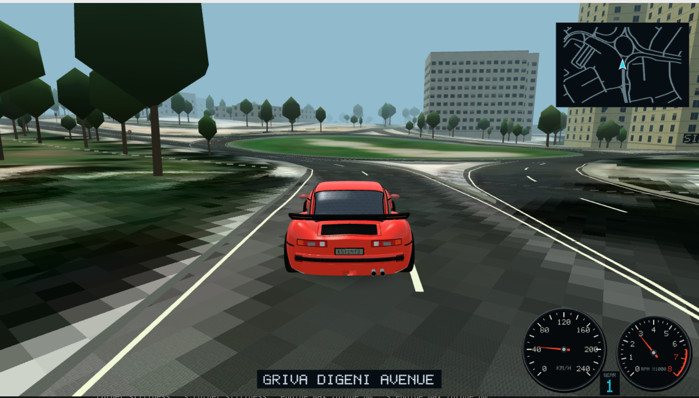

# Cars LOP

Experimental project: have an AI create a decent game and not even read the code.

Initially, every commit message was a one-line "ask" to the coding agent.
Everything else, including README.md outside of this section, was generated.

After 148 initial commits, the result is pretty decent, but one-line asks don't achieve their goals anymore.
I had to switch to longer negotiations to get improvements.
Also, I had to start looking into the code because generated technical decisions became idiotic as the slop level skyrocketed.

In-game screenshot at [Engomi, Nicosia](https://www.google.com/maps/search/?api=1&query=35.1670537,33.3169556)

## Controls

| Key                 | Action                               |
| ------------------- | ------------------------------------ |
| Up / Down           | Accelerate / brake                   |
| Left / Right        | Steer                                |
| A / Z               | Shift up / down                      |
| Space               | Handbrake                            |
| C                   | Cycle cameras                        |
| Esc                 | Pause / resume                       |
| R                   | Restart                              |
| H                   | Recover the car                      |
| M                   | Open / close the full map            |
| Mouse wheel / + / - | Zoom the full map in / out           |
| L                   | Return to location and car selection |
| V                   | Toggle audio mute                    |

## Usage

Run:

    $ cars <subcommand>

Subcommands:

- add-location <openstreetmap-url> <width-km> <height-km> - download and compile a rectangular location
- create-track track.json - compile a track from waypoints and add it to the location directory

## GLB models of the cars

Export static triangulated glTF 2.0 as `model.glb`: metres, Y up, +Z forward, one embedded
buffer and opaque materials. Name parts `body`, `wheel_rl`, `wheel_rr`,
`wheel_fl`, `wheel_fr`. Left/right wheels use negative/positive X.
Wheel origins are axle mounts; wheels spin about X and steer about Y.

Use vertex colours or solid PBR materials; textures, transparency, animation,
skinning, morphs, sparse accessors and external buffers are unsupported.
Material extras `{"carslop_material": [CODE, GLOSS]}` use gloss 0–1 and codes:
0 fixed colour, 1 paint, 2 glass, 3 metal, 4 optical lens, 5 brake lens,
6 reverse lens. Normals and winding must face outward.

## Engine audio

Cars automatically use `audio/engine.json` beside their `car.json` when present;
otherwise they use synthesized engine audio. No sample path is needed in the car
JSON. Cars can share a bank through an `audio` directory symlink.

Each bank lists RPM bands with load/coast WAV filenames, firing frequency and
crossfade overlap in frames. Export mono 48 kHz signed 16-bit PCM WAV files;
the loader validates their headers. WAV metadata chunks are supported. The
existing loops were converted without changing their audio samples.

Rebuild banks with `tools/build_engine_audio.py` (use `--pitsunda` for the Mazda
recording). See the audio attribution below for recording sources and licenses.

## Building models

Reusable window, entrance, and balcony GLBs live in `data/buildings/`.
`parts.json` selects the models and controls fitting, scaling, and placement.
Location baking combines these parts with mapped building shells into
`scene.pack`; play loads the baked geometry. See
[architectural asset conventions](data/buildings/README.md) for editing and export
instructions. Rebuild edited artwork with `cargo run -- bake-scene --location nicosia`.

## Credits and distribution

- **UI and sign font:** Noto Sans SemiBold and Bold, © 2018 The Noto Project Authors,
  from [Noto Fonts](https://github.com/notofonts/noto-fonts), under the
  [SIL Open Font License 1.1](data/fonts/noto-sans/OFL.txt).
  Include its copyright notice and license when distributing the game.
- **Maps:** © [OpenStreetMap contributors](https://www.openstreetmap.org/copyright),
  ODbL 1.0; extracts from Geofabrik ([Cyprus](https://download.geofabrik.de/europe/cyprus.html),
  [Rheinland-Pfalz](https://download.geofabrik.de/europe/germany/rheinland-pfalz.html)).
  Preserve attribution and source provenance when sharing derived map databases.
- **Elevation:** [Mapzen/Skadi](https://registry.opendata.aws/terrain-tiles/),
  USGS and EU-funded Copernicus EU-DEM; [source attribution and licenses](https://github.com/tilezen/joerd/blob/master/docs/attribution.md).
- **Imagery:** [Esri World Imagery](https://server.arcgisonline.com/ArcGIS/rest/services/World_Imagery/MapServer)
  — Esri, Vantor, Earthstar Geographics and the GIS User Community;
  pilot imagery from [Cyprus DLS Orthoimagery 2019](https://eservices.dls.moi.gov.cy/arcgis/rest/services/BASEMAPS/Orthoimagery_2019_WebMercator/MapServer).
  Redistribution permission is unconfirmed; do not redistribute imagery or
  derived assets without authorization.
- **Engine audio:** Pole Position Production's [1981 Porsche 911 SC recording](https://pole.se/the-iconic-sound-of-a-porsche-911-sc-from-1981/),
  `Porsche_911_SC_-81_t5_onboard_driving_constant_rpms_exhausts.wav`,
  from [Sonniss GDC 2016](https://sonniss.com/gameaudiogdc/), under the
  [Sonniss GDC bundle license](https://sonniss.com/gdc-bundle-license/).
  Modified load/coast excerpts are licensed game content, separate from the
  code license; distribute within the game, never as standalone recordings,
  sample packs, sound libraries or project templates.
- **Pitsunda engine audio:** Erwin Lindsen's [Mazda 2 1.3 Bifuel recording](https://commons.wikimedia.org/wiki/File:Mazda_2_-_engine_and_exhaust_sound_%28YouTube_3AZSUqSdUBI%29.opus),
  under [CC BY 3.0](https://creativecommons.org/licenses/by/3.0/).
  Modified into mono, filtered, pitch-stabilized, level-adjusted RPM loops. The source is an older
  1.3 Bifuel Mazda 2, used as an approximation for the 2016 Pitsunda;
  Commons marks the original YouTube license as awaiting verification.
