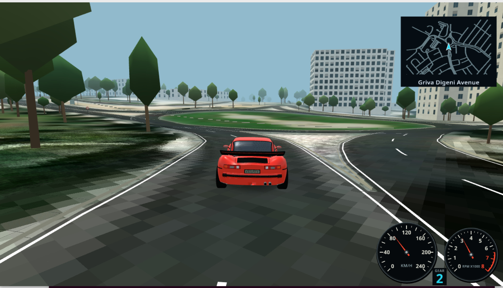

# Cars LOP

Experimental project: have an AI create a decent game and not even read the code.

Initially, every commit message was a one-line "ask" to the coding agent.
Everything else, including README.md outside of this section, was generated.

After 148 initial commits, the result is pretty decent, but one-line asks don't achieve their goals anymore.
I had to switch to longer negotiations to get improvements.
Also, I had to start looking into the code because generated technical decisions became idiotic as the slop level skyrocketed.

In-game screenshot at [Engomi, Nicosia](https://www.google.com/maps/search/?api=1&query=35.1670537,33.3169556)

## Usage

Run:

    $ cars <subcommand>

Subcommands:

- add-location <openstreetmap-url> <width-km> <height-km> - download and compile a rectangular location
- create-track track.json - compile a track from waypoints and add it to the location directory

## Credits

- **UI and sign font:** Noto Sans SemiBold and Bold, © 2018 The Noto Project Authors,
  from [Noto Fonts](https://github.com/notofonts/noto-fonts), under the
  [SIL Open Font License 1.1](data/fonts/noto-sans/OFL.txt).
  Include its copyright notice and license when distributing the game.
- **Maps:** © [OpenStreetMap contributors](https://www.openstreetmap.org/copyright),
  ODbL 1.0; extracts from Geofabrik ([Cyprus](https://download.geofabrik.de/europe/cyprus.html),
  [Rheinland-Pfalz](https://download.geofabrik.de/europe/germany/rheinland-pfalz.html)).
  Preserve attribution and source provenance when sharing derived map databases.
- **Elevation:** [Mapzen/Skadi](https://registry.opendata.aws/terrain-tiles/),
  USGS and EU-funded Copernicus EU-DEM; [source attribution and licenses](https://github.com/tilezen/joerd/blob/master/docs/attribution.md).
- **Imagery:** [Esri World Imagery](https://server.arcgisonline.com/ArcGIS/rest/services/World_Imagery/MapServer)
  — Esri, Vantor, Earthstar Geographics and the GIS User Community;
  pilot imagery from [Cyprus DLS Orthoimagery 2019](https://eservices.dls.moi.gov.cy/arcgis/rest/services/BASEMAPS/Orthoimagery_2019_WebMercator/MapServer).
  Redistribution permission is unconfirmed; do not redistribute imagery or
  derived assets without authorization.
- **Collision audio:** dslrguide's [Metal Hit 2](https://freesound.org/people/dslrguide/sounds/321482/)
  and squareal's [Car Crash](https://freesound.org/people/squareal/sounds/237375/),
  under [CC0 1.0](https://creativecommons.org/publicdomain/zero/1.0/).
  Filtered and trimmed into impact samples from the public MP3 previews;
  [source and rebuild details](data/audio/impacts/README.md).
- **Tyre squeal:** audible-edge's [Chrysler LHS tyre squeal 04](https://freesound.org/people/audible-edge/sounds/71739/),
  under [CC0 1.0](https://creativecommons.org/publicdomain/zero/1.0/).
  Filtered, level-adjusted and crossfaded into a loop from the supplied MP3 preview;
  [source and rebuild details](data/audio/tires/README.md).
- **Engine audio:** Pole Position Production's [1981 Porsche 911 SC recording](https://pole.se/the-iconic-sound-of-a-porsche-911-sc-from-1981/),
  `Porsche_911_SC_-81_t5_onboard_driving_constant_rpms_exhausts.wav`,
  from [Sonniss GDC 2016](https://sonniss.com/gameaudiogdc/), under the
  [Sonniss GDC bundle license](https://sonniss.com/gdc-bundle-license/).
  Modified load/coast excerpts are licensed game content, separate from the
  code license; distribute within the game, never as standalone recordings,
  sample packs, sound libraries or project templates.
- **Pitsunda engine audio:** Erwin Lindsen's [Mazda 2 1.3 Bifuel recording](https://commons.wikimedia.org/wiki/File:Mazda_2_-_engine_and_exhaust_sound_%28YouTube_3AZSUqSdUBI%29.opus),
  under [CC BY 3.0](https://creativecommons.org/licenses/by/3.0/).
  Modified into mono, filtered, pitch-stabilized, level-adjusted RPM loops. The source is an older
  1.3 Bifuel Mazda 2, used as an approximation for the 2016 Pitsunda;
  Commons marks the original YouTube license as awaiting verification.

- **Mosquito engine audio:** Pole Position Production's [1971 Camaro Z28 recording](https://pole.se/product/camaro-z28-71/),
  `Camaro_Z28_-71_t8_onboard_startup_driving_shutdown_rolling_Intake.wav`,
  from [Sonniss GDC 2016](https://sonniss.com/gameaudiogdc/), under the
  [Sonniss GDC bundle license](https://sonniss.com/gdc-bundle-license/).
